<picture><source media="(prefers-color-scheme: dark)" srcset="assets/hero-dark.svg">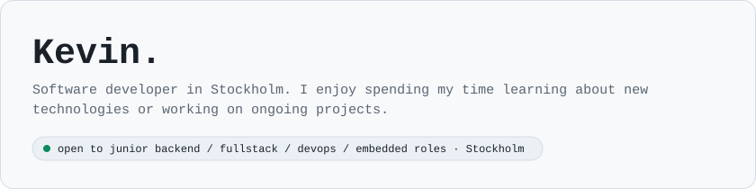</picture>

<a href="https://www.linkedin.com/in/kevin-juselius-vallin"><picture><source media="(prefers-color-scheme: dark)" srcset="assets/link-linkedin-dark.svg">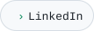</picture></a>
<a href="https://objekt.live"><picture><source media="(prefers-color-scheme: dark)" srcset="assets/link-objekt-dark.svg">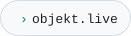</picture></a>
<a href="https://musicbox.website"><picture><source media="(prefers-color-scheme: dark)" srcset="assets/link-musicbox-dark.svg">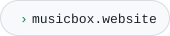</picture></a>

<picture><source media="(prefers-color-scheme: dark)" srcset="assets/label-build-dark.svg"></picture>

<a href="https://github.com/Keffii/storefront"><picture><source media="(prefers-color-scheme: dark)" srcset="assets/project-objekt-dark.svg">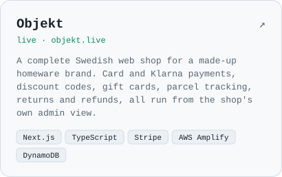</picture></a>
<a href="https://github.com/Keffii/music_box"><picture><source media="(prefers-color-scheme: dark)" srcset="assets/project-musicbox-dark.svg">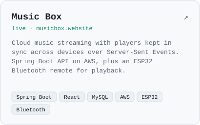</picture></a>
<a href="https://github.com/Keffii/pico_voltage_dip_monitor"><picture><source media="(prefers-color-scheme: dark)" srcset="assets/project-dipmonitor-dark.svg">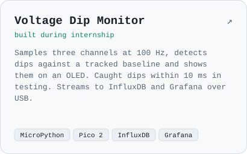</picture></a>
<a href="https://github.com/Keffii/space_survivors"><picture><source media="(prefers-color-scheme: dark)" srcset="assets/project-spacesurvivors-dark.svg">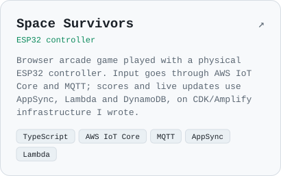</picture></a>

<picture><source media="(prefers-color-scheme: dark)" srcset="assets/label-stack-dark.svg">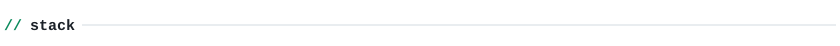</picture>

<picture><source media="(prefers-color-scheme: dark)" srcset="assets/stack-dark.svg">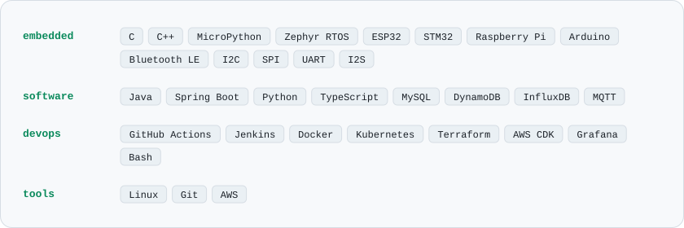</picture>

<picture><source media="(prefers-color-scheme: dark)" srcset="assets/label-activity-dark.svg"></picture>

<picture><source media="(prefers-color-scheme: dark)" srcset="assets/stats-dark.svg">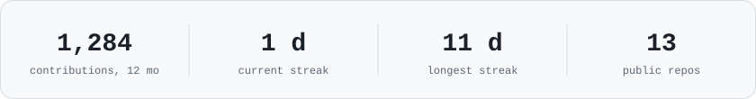</picture>

<picture><source media="(prefers-color-scheme: dark)" srcset="assets/heatmap-dark.svg">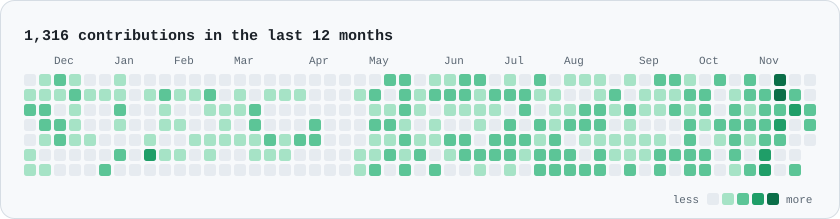</picture>
